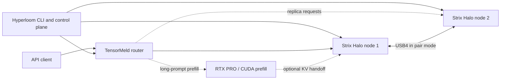

<p align="center"></p>

# Hyperloom

**One control plane for AI inference across different machines.** Hyperloom brings a Windows workstation with an NVIDIA GPU and AMD Strix Halo Linux mini-PCs into one explicitly configured cluster. It installs pinned components, manages their lifecycle, starts a router, and gives operators a unified view of nodes, links, logs, and performance.

> [!IMPORTANT]
> **Development status — not production-ready (2026-10-25 evening):** deployment and the DeepSeek pair have passed hardware acceptance. The local portal has a hardware start/stop smoke test, with crash-cleanup acceptance still open. RTX prefill build, standalone exactness and capped placement are validated; the complete pair + RTX placement run remains pending. Recipe orchestration, the expanded portal and context-aware placement are pending integration.

## What problem does it solve?

Large models, fast prefill, and high-throughput decoding may need different hardware. Running each engine manually across multiple machines means coordinating versions, network endpoints, model files, launches, GPU reservations, and failures yourself.

Hyperloom is the **integration and orchestration layer**, not another inference engine. It connects:

| Component | Responsibility |
|---|---|
| [TensorMeld](https://github.com/hyukudan/tensormeld) | Request routing, replica balancing, placement and benchmarking |
| [Strix Halo Engine](https://github.com/hyukudan/strix-halo-engine-lab) | AMD HIP decode workers and an NVIDIA CUDA prefill service |
| [Strix Trellis](https://github.com/hyukudan/strix-trellis) | Quantized dense kernels used by supported engine profiles |
| **Hyperloom** | Reproducible installs, configuration, machine checks, safe process lifecycle, CLI and local portal |

**Accepted deployments:** two Strix Halo nodes can serve Qwen replicas or run DeepSeek as a pair over USB4. Optional long-prompt prefill on an RTX PRO 6000 (96 GB, Windows WDDM) has standalone validation; end-to-end acceptance through Hyperloom is still pending. Per-preset engine adapters also cover MiniMax; see [pins and launch constraints](docs/adapters.md).

## How it fits together



The CLI uses a versioned cluster configuration and pinned releases. Machines are added explicitly via SSH with host-key verification; GPU jobs run under supervised leases. The router can run locally or on a linked machine. See [architecture and lifecycle details](docs/README-technical.md#architecture).

## Getting started

**Prerequisites (control machine):** Python 3.11+, Git and OpenSSH. The Windows installation workflow is documented in [Installation](docs/install.md), including node prerequisites and rollback.

```powershell
git clone --recurse-submodules https://github.com/hyukudan/hyperloom.git
cd hyperloom
.\windows\install.ps1
hloom --help
```

Then use [the sample cluster configuration](examples/cluster.example.json) to describe your machines, model assets and profiles:

```powershell
hloom config validate "$env:APPDATA\hyperloom\cluster.json"
hloom doctor halo-1
hloom doctor halo-2
hloom render qwen-replicas
```

**Hardware acceptance covers phases 1a and 2, with a partial portal smoke test;** see the acceptance documents. The staged install/start/stop workflow and its constraints are explained in [the detailed quick start](docs/README-technical.md#quick-start). Not every documented future option is implemented: notably `--plan` and `--allow-partial` are planned.

## Current status

| Phase | Status |
|---|---|
| 0 — configuration, rendering and local router control | Complete |
| 1a — deployment and node supervision | Accepted on real hardware (2026-10-23, Qwen replicas) |
| 1b — local monitoring portal | Implemented on main; real node data and Qwen start/stop exercised; portal-exit cleanup test still open |
| 2 — validated cluster profiles and operational workflows | Accepted on real hardware (2026-10-23/24, DeepSeek pair) |
| 3 — optional RTX prefill and heterogeneous inference extensions | 3a in progress: CUDA build and prefill service on the RTX PRO accepted (fidelity gate equal to the exact reference at 512 / 2K / 8K / 32K); pair + RTX placement through `up` pending; optional operator gate before the device is touched |
| 4 — operational extensions | Installation/release tooling, qualified knobs, diagnostics, Prometheus export and optional non-lab service mode implemented; discovery/pairing and Windows workers remain later work |

These statuses describe **Hyperloom integration work**, not the maturity of individual underlying engines. See the [full roadmap and acceptance criteria](docs/SPEC.md) and the acceptance records for [Phase 1a](docs/acceptance-1a.md), [Phase 2](docs/acceptance-2.md) and [Phase 3a](docs/acceptance-3a.md).

### Measured integration results

Hyperloom versus the same engine launched by the lab, on two Strix Halo nodes (DeepSeek uses USB4). Token identity is relative to the named quantized profile. Historical component-only results remain in the [technical overview](docs/README-technical.md#performance).

| Profile / conditions | Measured result | Evidence |
|---|---|---|
| Qwen3.8-Flash-Next, UD-Q4_K_XL + Q8_0 MTP, context 12,288; 8 greedy prompts, up to 64 output tokens | 478 tokens identical across both launchers | [2026-10-23 acceptance](docs/acceptance-1a.md) |
| DeepSeek V4.1 Flash, Q2 experts + 6.5-bit overlay and trellis mix-B, context 4,096; 8 fixed prompts × 192 output tokens, C1 / C4 | Full Hyperloom start: 36.5 / 55.9 tok/s aggregate; separate greedy gate: 290 identical tokens | [2026-10-23/24 acceptance](docs/acceptance-2.md) |
| DeepSeek updated preset, same base quantization with trellis attention/dense sites enabled, context 4,096; 8 fixed prompts × 192 output tokens, C1 / C4 | 39.4 / 64.7 tok/s aggregate; separate greedy gate: 284 tokens identical in all three A/B/A arms | [2026-10-24 adapter check](docs/adapters.md#hardware-check-ds41-pair-w5-2026-10-24) |

The updated-preset comparison uses engine `cab238d6` + trellis `c95a1695`: Hyperloom versus a manual build of the same commits. DeepSeek prompt lengths/categories are not recorded in the acceptance summaries. These integration runs have no reported hardware ceiling.

Pending integration follows these decisions:

| Work | Design / current boundary |
|---|---|
| Recipes and portal deployment | Shared CLI validation, immutable launch-input snapshots and request-time resource checks. Router pin update and hardware qualification remain prerequisites; built-in recipes are not accepted deployments. |
| Context-aware placement | The operator chooses context and a speed/context trade-off; the validated plan becomes launch input. Predictions are labelled; model/context/engine/driver/budget changes invalidate it. This extends the current [capped prefill planner](docs/vramplan.md) and is pending implementation. |
| Budgets and probes | Every GPU needs its own grant; pinned/pageable host budgets are separate. Probes are explicit and receipts cached; passive planning runs no GPU work and never adds another GPU automatically. |
| Expanded portal | Telemetry history, fleet/health views, benchmarks and operations are implemented in pending branch work, awaiting integration and acceptance. |

## Documentation

| Guide | What you'll find |
|---|---|
| [Installation](docs/install.md) | From-scratch setup, prerequisites, releases, upgrades and rollback |
| [Technical overview](docs/README-technical.md) | Original detailed README: architecture, requests, leases, builds, component pins, measurements and security |
| [System specification and roadmap](docs/SPEC.md) | Planned phases, design constraints and acceptance gates |
| [Adapters](docs/adapters.md) | Interfaces to the underlying engines and router |
| [Model assets](docs/assets.md) and [downloads](docs/model-downloads.md) | Asset verification and acquisition |
| [UI specification](docs/ui/UI-SPEC.md) | Planned local portal designs, explicitly mockups |
| [Performance and diagnostic runs](docs/diagnostic-runs.md) | Measurement context and diagnostics |

## Design principles

**AMD-first inference, heterogeneous orchestration.** Hyperloom supports Strix Halo decode nodes while coordinating other resources when a profile requires them. It uses pinned upstream components rather than duplicating their kernels or inference implementations. Configuration is explicit; remote SSH commands are allow-listed; leases own GPU work; partial starts must clean up safely.

For the complete security model and limitations, see [Technical overview — Security](docs/README-technical.md#security).

## Tests

Install the test extra with `python -m pip install -e ".[test]"`, then run `python -m pytest -q`.
Pytest runs both the existing unittest classes and the placement fixture/parameter tests on Windows and Linux.
The pinned TensorMeld submodule must be available for router/parser and planner tests.

## License

Copyright © 2026 hyukudan. **Proprietary; no license is granted.** See [LICENSE](LICENSE) and [NOTICE](NOTICE) for separate component licenses.
