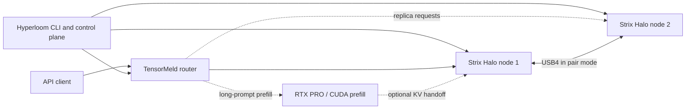

<p align="center"></p>

# Hyperloom

**One control plane for AI inference across different machines.** Hyperloom brings a Windows workstation with an NVIDIA GPU and AMD Strix Halo Linux mini-PCs into one explicitly configured cluster. It installs pinned components, manages their lifecycle, starts a router, and gives operators a unified view of nodes, links, logs, and performance.

> [!IMPORTANT]
> **Development status — not production-ready:** Phase 0 is complete. Phase 1a (deployment and node supervision) was accepted on real hardware on 2026-10-23 and Phase 2 (validated profiles, DeepSeek pair) on 2026-10-23/24, including a token regression gate: 8 of 8 greedy prompts identical between the Hyperloom launch and the reference launch. The optional RTX prefill extension is partly validated (build and service on the RTX PRO accepted; the pair + RTX placement run is pending). Performance results published in the technical documentation come from the component projects running independently, not from a Hyperloom deployment. This repository is private and proprietary.

## What problem does it solve?

Large models, fast prefill, and high-throughput decoding may need different hardware. Running each engine manually across multiple machines means coordinating versions, network endpoints, model files, launches, GPU reservations, and failures yourself.

Hyperloom is the **integration and orchestration layer**, not another inference engine. It connects:

| Component | Responsibility |
|---|---|
| [TensorMeld](https://github.com/hyukudan/tensormeld) | Request routing, replica balancing, placement and benchmarking |
| [Strix Halo Engine](https://github.com/hyukudan/strix-halo-engine-lab) | AMD HIP decode workers and an NVIDIA CUDA prefill service |
| [Strix Trellis](https://github.com/hyukudan/strix-trellis) | Quantized dense kernels used by supported engine profiles |
| **Hyperloom** | Reproducible installs, configuration, machine checks, safe process lifecycle, CLI and planned portal |

**Example deployments:** two Strix Halo nodes can serve independent replicas, or work as a USB4-connected inference pair. An RTX PRO workstation can perform long-prompt prefill for supported workflows. These are **component capabilities and intended profiles**, not a claim that the complete Hyperloom integration has passed hardware acceptance.

## How it fits together



The CLI uses a versioned cluster configuration and pinned releases. Machines are added explicitly via SSH with host-key verification; GPU jobs run under supervised leases. The router can run locally or on a linked machine. See [architecture and lifecycle details](docs/README-technical.md#architecture).

## Getting started

**Prerequisites (control machine):** Python 3.11+, Git and OpenSSH. The Windows installation workflow is documented in [Installation](docs/install.md), including node prerequisites and rollback.

```powershell
git clone --recurse-submodules https://github.com/hyukudan/hyperloom.git
cd hyperloom
.\windows\install.ps1
hloom --help
```

Then use [the sample cluster configuration](examples/cluster.example.json) to describe your machines, model assets and profiles:

```powershell
hloom config validate "$env:APPDATA\hyperloom\cluster.json"
hloom doctor halo-1
hloom doctor halo-2
hloom render qwen-replicas
```

**Hardware acceptance covers phases 1a and 2;** see the acceptance documents. The staged install/start/stop workflow and its constraints are explained in [the detailed quick start](docs/README-technical.md#quick-start). Not every documented future option is implemented: notably `--plan` and `--allow-partial` are planned.

## Current status

| Phase | Status |
|---|---|
| 0 — configuration, rendering and local router control | Complete |
| 1a — deployment and node supervision | Accepted on real hardware (2026-10-23, Qwen replicas) |
| 1b — local monitoring portal | Implemented on main (thin web UI over the CLI); no acceptance record yet |
| 2 — validated cluster profiles and operational workflows | Accepted on real hardware (2026-10-23/24, DeepSeek pair) |
| 3 — optional RTX prefill and heterogeneous inference extensions | 3a in progress: CUDA build and prefill service on the RTX PRO accepted (fidelity gate equal to the exact reference at 512 / 2K / 8K / 32K); pair + RTX placement through `up` pending; optional operator gate before the device is touched |
| 4 — discovery, pairing and other operational extensions | Later |

These statuses describe **Hyperloom integration work**, not the maturity of individual underlying engines. See the [full roadmap and acceptance criteria](docs/SPEC.md) and the acceptance records for [Phase 1a](docs/acceptance-1a.md), [Phase 2](docs/acceptance-2.md) and [Phase 3a](docs/acceptance-3a.md).

## Documentation

| Guide | What you'll find |
|---|---|
| [Installation](docs/install.md) | From-scratch setup, prerequisites, releases, upgrades and rollback |
| [Technical overview](docs/README-technical.md) | Original detailed README: architecture, requests, leases, builds, component pins, measurements and security |
| [System specification and roadmap](docs/SPEC.md) | Planned phases, design constraints and acceptance gates |
| [Adapters](docs/adapters.md) | Interfaces to the underlying engines and router |
| [Model assets](docs/assets.md) and [downloads](docs/model-downloads.md) | Asset verification and acquisition |
| [UI specification](docs/ui/UI-SPEC.md) | Planned local portal designs, explicitly mockups |
| [Performance and diagnostic runs](docs/diagnostic-runs.md) | Measurement context and diagnostics |

## Design principles

**AMD-first inference, heterogeneous orchestration.** Hyperloom supports Strix Halo decode nodes while coordinating other resources when a profile requires them. It uses pinned upstream components rather than duplicating their kernels or inference implementations. Configuration is explicit; remote SSH commands are allow-listed; leases own GPU work; partial starts must clean up safely.

For the complete security model and limitations, see [Technical overview — Security](docs/README-technical.md#security).

## License

Copyright © 2026 hyukudan. **Private and proprietary; no license is granted.** See [LICENSE](LICENSE) and [NOTICE](NOTICE) for separate component licenses.
