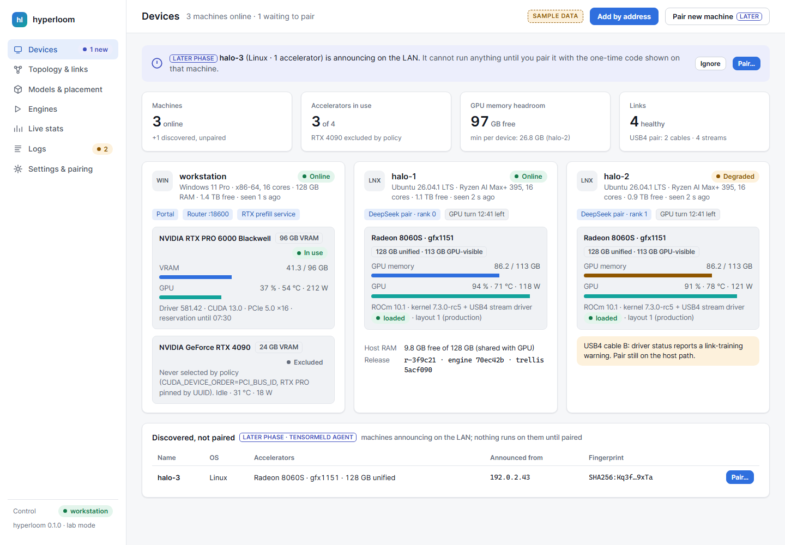
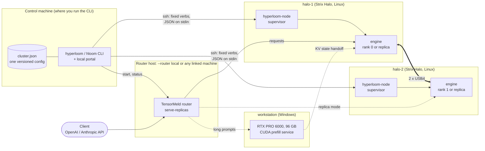
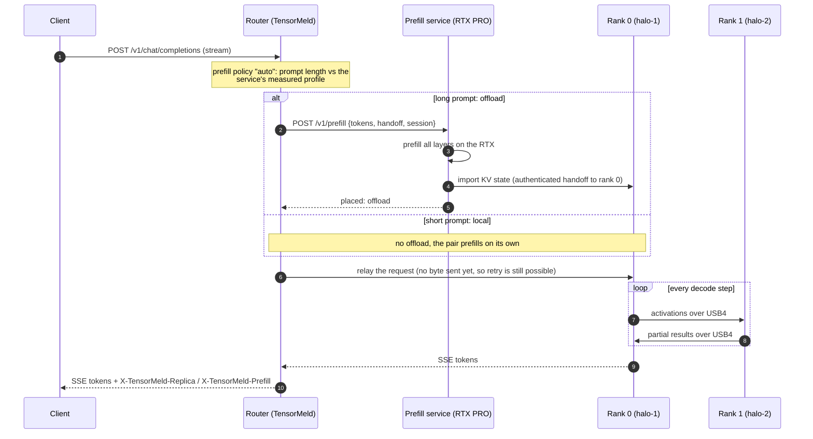
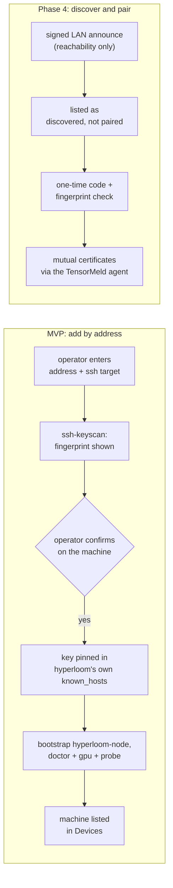
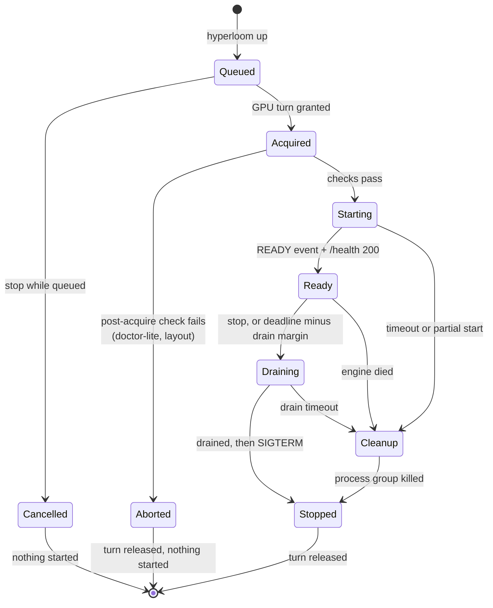
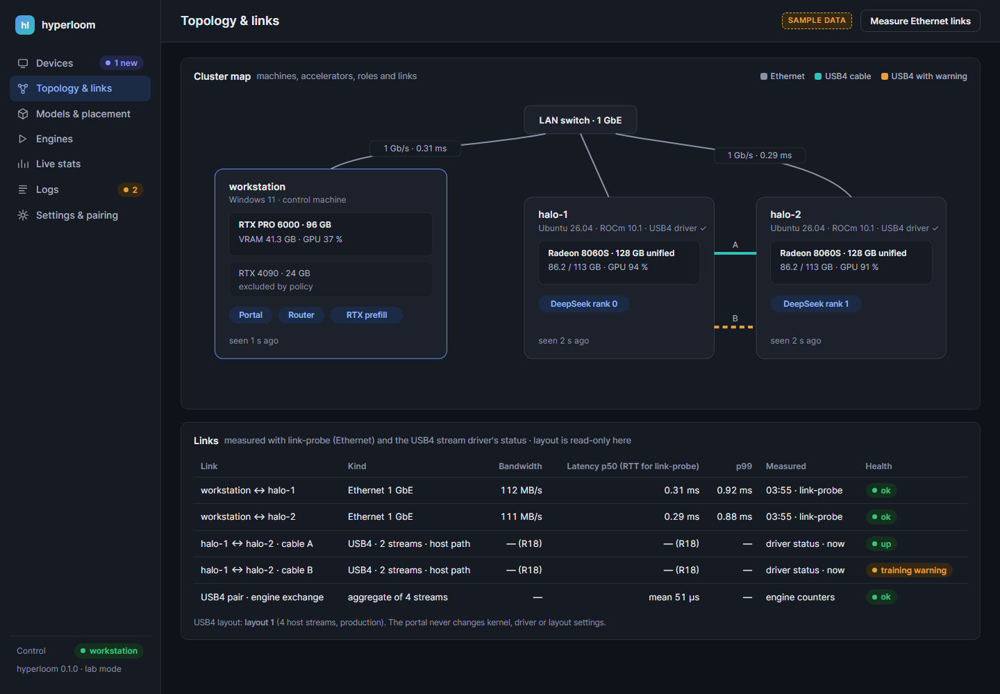
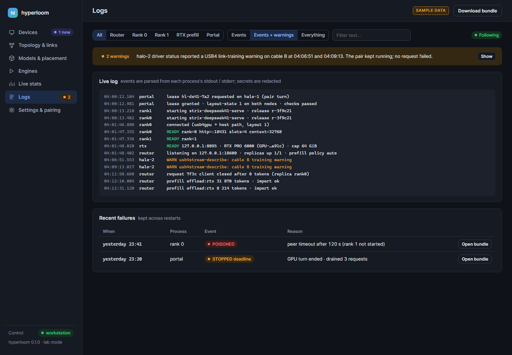
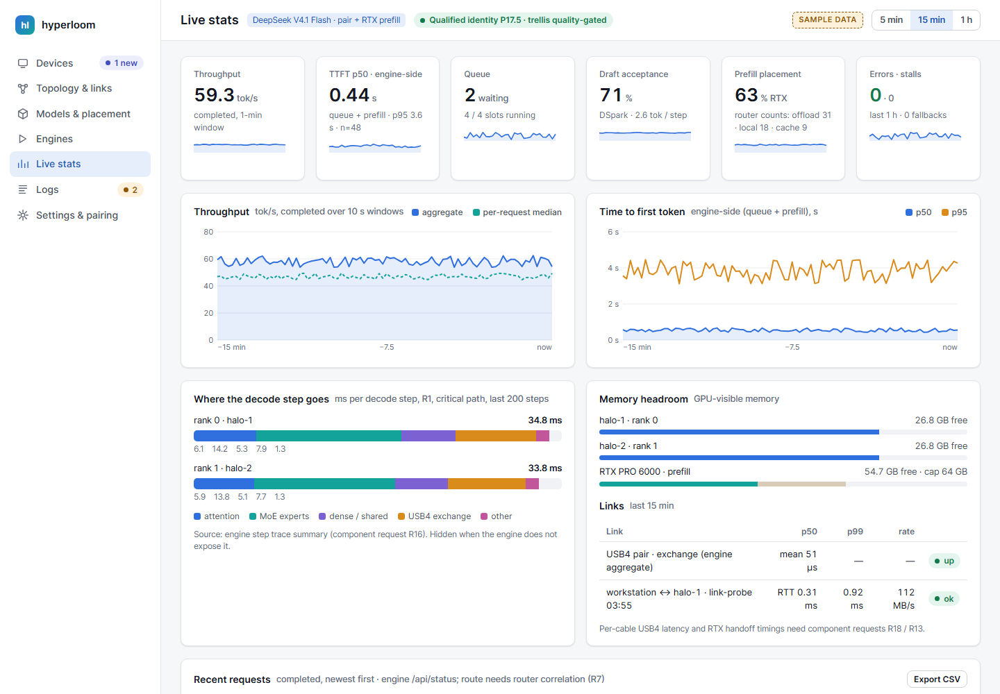
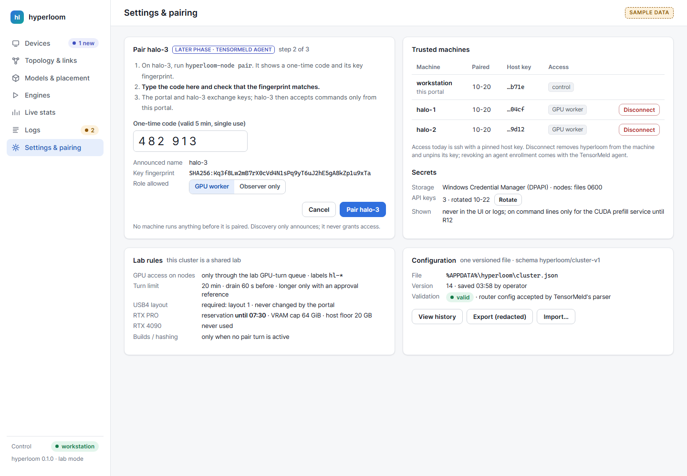

# hyperloom

**One loom for unlike machines: a Windows workstation with a big discrete GPU and a set of AMD Strix Halo mini PCs, woven into one inference cluster.**

hyperloom is the integration and control layer that turns three separate projects into one installable system: [TensorMeld](https://github.com/hyukudan/tensormeld) (router, planner, benchmarks), the [Strix Halo engine](https://github.com/hyukudan/strix-halo-engine-lab) (HIP serving apps and a CUDA prefill service) and [strix-trellis](https://github.com/hyukudan/strix-trellis) (trellis-quantized dense kernels). Each component is pinned by commit and driven only through the interfaces it already has: command-line flags, config files, stdout events and its HTTP endpoints. hyperloom adds what was missing between them: pinned builds, one config file, safe start and stop on every machine, a router you can place anywhere, and one view of devices, links, statistics and logs.

> [!IMPORTANT]
> **Status (2026-10-25 evening):** Phases 1a and 2 accepted on hardware; portal start/stop smoke-tested, with crash-cleanup acceptance open. RTX build, standalone exactness and capped placement validated; pair + RTX placement remains pending. See the [current overview](../README.md#current-status) and [acceptance records](acceptance-2.md).

<p align="center">
  
  <br><sub><b>Mockup with sample data</b>, not a running system: the Devices screen of the planned portal.</sub>
</p>

## Contents

[Architecture](#architecture) ·
[Quick start](#quick-start) ·
[How it works](#how-it-works) ·
[The portal](#the-portal-mockups) ·
[Components](#components) ·
[Performance](#performance) ·
[Status and roadmap](#status-and-roadmap) ·
[Security](#security) ·
[License](#license)

## Architecture



- **The CLI runs wherever the operator is.** Typically that is the Windows workstation; the same stdlib Python also runs on Linux.
- **The router runs where you say at launch:** on the CLI's machine by default, or on any linked machine.
- **Nodes and devices are linked explicitly** (flags or a plan file) and must be reachable; nothing joins the cluster on its own.
- **Every GPU process on a node is started by `hyperloom-node supervise`**, inside a GPU lease, and is stopped by it too.

Everything in the boxes comes from pinned components. hyperloom itself contains no inference code, no kernels and no numerics.

## Quick start

> [!NOTE]
> The Phase 1a CLI and Phase 2 pair have [passed hardware acceptance](acceptance-2.md). Optional RTX placement through the full deployment remains pending. Plan files (`--plan`) and `--allow-partial` are specified but not implemented. `hloom` is a short alias for `hyperloom` everywhere.

**1. Install on the control machine** (Windows, Python ≥ 3.11, git, OpenSSH client). The full from-scratch guide, including release archives, Linux, node prerequisites, upgrades and rollback, is [docs/install.md](../docs/install.md):

```powershell
git clone --recurse-submodules https://github.com/hyukudan/hyperloom.git
cd hyperloom
.\windows\install.ps1            # one venv, TensorMeld + hyperloom, Start-menu shortcut
hloom --help
```

`install.ps1` resolves one interpreter, creates a venv under `%LOCALAPPDATA%\hyperloom\venv` and installs TensorMeld from the pinned submodule. It has no other dependencies and supports `-WhatIf`.

**2. Describe the cluster** in `%APPDATA%\hyperloom\cluster.json` (`~/.config/hyperloom/cluster.json` on Linux). It holds machines, asset paths with their expected size and sha256, and profiles; it **never holds secrets**, only key-file paths. A complete example is [`examples/cluster.example.json`](../examples/cluster.example.json); the shape, abridged:

```jsonc
{ "schema": "hyperloom/cluster-v1",
  "machines": [
    { "id": "workstation", "os": "windows", "access": "local",
      "http_address": "127.0.0.1", "install_root": "C:/hyperloom" },
    { "id": "halo-1", "os": "linux", "access": "ssh", "http_address": "192.0.2.10",
      "ssh_target": "halo-1", "install_root": "/opt/hyperloom", "lab_mode": true,
      "devices": [ { "id": "gpu", "type": "amd" } ] },
    { "id": "halo-2", … } ],
  "assets":   { "halo-1": { "model": { "path": "…", "bytes": 0, "sha256": "…" }, … }, … },
  "profiles": { "qwen-replicas": { "nodes": ["halo-1", "halo-2"], "port": 18501, "receipt": "qwen-rep-rfix", … },
                "ds41-pair":     { "rank0": "halo-1", "rank1": "halo-2", "port": 18431, … } },
  "router":   { "machine": "local", "policy": "auto", "balance_active_decodes": true, "max_inflight": 8 } }
```

```powershell
hloom config validate "$env:APPDATA\hyperloom\cluster.json"   # strict schema check, unknown keys rejected
hloom render qwen-replicas     # router JSON + exact argv/env per process, checked by TensorMeld's own parser
hloom router start             # Phase 0: the rendered router as a local child (Job Object), then status / stop
```

**3. Check every machine** (read-only; every command run is listed in the output):

```powershell
hloom doctor halo-1
hloom doctor halo-2
```

The first contact with a machine pins its ssh host key: hyperloom shows the full SHA-256 fingerprint and you confirm it against the machine itself.

**4. Install the pinned engine on the nodes, then bring a profile up**, choosing where the router runs and what to link:

```powershell
# Build once on halo-1 (CPU only, scheduled outside GPU turns), copy to halo-2, verify every sha, activate both
hloom install qwen-replicas --build-on halo-1

# Router on this machine (the default), two Qwen replicas
hloom up qwen-replicas --node halo-1 --node halo-2

# DeepSeek pair, router on halo-1, RTX prefill on the workstation
hloom up ds41-rtx --router halo-1 --node halo-1 --node halo-2 --device workstation:rtx-pro

# Planned: the same choices from a file (schema hyperloom/launch-v1)
# hloom up --plan my-launch.json

hloom status qwen-replicas
hloom logs qwen-replicas router --tail 200
hloom down qwen-replicas
```

**How linking works.** hyperloom links the machines and devices that are both **declared** (by `--node`, `--device` or the plan file) and **reachable** (added, host key pinned, doctor passing). If a declared machine or device is unreachable, `up` fails **before** any GPU lease is taken and names what is missing. A planned `--allow-partial` will relax this only for profiles that define a degraded form, such as one Qwen replica instead of two. With `--router <machine>`, the router listens on that machine's private address with a key file, because TensorMeld requires one for any non-loopback listen.

## How it works

### A request through the cluster

Intended full request path for DeepSeek V4.1 Flash with the RTX prefill service (Phase 3a; end-to-end Hyperloom acceptance pending). A short prompt skips the dashed branch and is prefilled on the pair itself.



The router retries a request on another replica only if no byte has been sent to the client yet. Health, status and metrics are read from the same router and engine endpoints that the portal polls.

### Who does what: splitting work across devices

| Device | Role | Why |
|---|---|---|
| **RTX PRO 6000** (96 GB, CUDA) | **prefill** of long prompts | Prefill is compute-bound. The discrete GPU reads the whole prompt fast and hands the finished KV state to rank 0. |
| **Two Strix Halo nodes** (128 GB unified each, ROCm) | **decode**, as a tensor-parallel pair over two USB4 cables, or as two independent replicas | Decode is memory-bound and needs the whole model resident. Two 128 GB nodes hold a model that does not fit in 96 GB of VRAM. |
| **Control machine** | CLI, portal, router (by default) | Stateless and light; it can move to any machine with `--router`. |

Profiles are mutually exclusive per node: the Qwen replicas (about 107 GiB per node) and the DeepSeek pair (about 80 GiB per node) never share one. Splitting **decode** itself across the RTX and the pair (layers 0-21 on the GPU, the rest on the nodes) has been measured as an experiment (see [Performance](#performance)). It becomes a profile only once the engine ships that front end as an HTTP server (Phase 3b).

### Device discovery and joining



- **Today's path is ssh with the operator's keys.** Nothing listens on a worker. Every later ssh call is pinned to the recorded key (`StrictHostKeyChecking=yes` against hyperloom's own `known_hosts`), so a changed key is a hard failure.
- **Inventory** comes from `tensormeld probe` (OS, RAM, NVIDIA devices) and `hyperloom-node doctor` / `gpu` (CPU, AMD memory from sysfs, ROCm version, kernel, USB4 stream driver and layout). These are passive reads that do not initialize the GPU.
- **Discovery never grants anything.** A machine that announces itself is listed as "discovered, not paired" and cannot run work until the operator pairs it explicitly.

### GPU leases

On the nodes, a GPU process only starts inside a **lease**, which is exactly one turn of the node's GPU queue (or a pair turn holding both nodes). The lease has a hard deadline; `hyperloom-node supervise` is its single foreground owner.



- **Deadline.** The default is the single-turn cap (20 min) minus a 60 s drain margin. A longer lease needs an explicit approval (`--approval-ref "<ref>" --approval-lease <s> --approval-end <time>`) that names the owner, maximum duration and end time; it is logged and shown in the portal, and refused once the approval has expired. hyperloom never writes approvals itself.
- **Checks after acquiring, not before.** Pair profiles re-check that both nodes are in the production USB4 layout once the turn is held, and abort with nothing started otherwise.
- **No orphans.** Engines run in their own process groups under `supervise`. Partial starts (rank 1 up, rank 0 failing) are cleaned up on both nodes. `supervise` does not depend on the controller's ssh session: if the CLI dies, the lease runs to its deadline and `hyperloom status` reattaches.
- **Labels** are `hl-<profile>-<short id>`, from a namespace that provably maps to no layout change on the node side.

### Builds and releases

- **Pinned sources.** Nodes fetch each component by SHA and build with a fixed recipe from `versions.lock` (ROCm 10.1, `gfx1151`, Release). The build runs at low priority with a memory cap and is refused while a pair turn is held.
- **Immutable releases.** A release id is the sha256 of a manifest that covers component SHAs, the configure recipe, toolchain versions, presets and the sha256 of every binary. Processes launch from `releases/<id>/bin/`, never through a moving symlink.
- **Two-node activation is transactional.** Build on halo-1, copy to halo-2, verify every binary sha, then activate both or neither, only while the profile is stopped. A pair always runs the same release on both ranks.
- **Presets equal receipts.** Rendering a profile with no overrides reproduces the argv and env of its qualified run exactly (tokenized comparison, golden-tested). Any friendlier default is a named, visible override; numerics, model identity, transport and layout are never editable.

## The portal (mockups)

The implemented thin local web UI uses the same functions as the CLI (Phase 1b; [hardware smoke test and remaining checks](acceptance-1a.md#phase-1b-portal-on-real-hardware)): stdlib `http.server` on loopback, vanilla JS, no CDN and no build step. **Every image below is a design mockup with sample data, not a screenshot of a running system.**

<table>
  <tr>
    <td width="50%"><br><sub><b>Topology & links</b> (mockup): machines, roles, Ethernet and USB4 links, with how each value was obtained.</sub></td>
    <td width="50%"><br><sub><b>Logs</b> (mockup): one merged log with parsed events (lease granted, READY, warnings) and recent failures with a redacted bundle.</sub></td>
  </tr>
  <tr>
    <td width="50%"><br><sub><b>Live stats</b> (mockup): every value says whether it is client-side or engine-side; missing sources show "unavailable", never zero.</sub></td>
    <td width="50%"><br><sub><b>Settings & pairing</b> (mockup): trusted machines and their pinned keys, secrets, lab rules and the versioned config. Pairing by code is a later phase.</sub></td>
  </tr>
</table>

The full design, with all seven screens in light, dark and narrow layouts, is in [docs/ui/UI-SPEC.md](../docs/ui/UI-SPEC.md).

## Components

Pinned in [`versions.lock`](../versions.lock) and as git submodules under `third_party/` (read-only here). Pin changes are ordinary reviewed commits.

| Component | Pin | License | What hyperloom uses |
|---|---|---|---|
| [TensorMeld](https://github.com/hyukudan/tensormeld) | `7165e98` (0.2.0a2) on the nodes; `409003a` for the local router (see SPEC 1.1) | MIT | `serve-replicas` router (`replica-router-v1`: OpenAI/Anthropic relay with SSE, replica balancing, prefill placement, `/api/status`, `/metrics`); `probe` and `link-probe` for inventory and links; `plan-hetero` for placement proposals; `bench-protocol` for client-side benchmarks. Its config parser validates every router config hyperloom renders. |
| [Strix Halo engine](https://github.com/hyukudan/strix-halo-engine-lab) | `70ec42b9` | Apache-2.0 | `strix-hip-decode-token --http-serve` (Qwen replicas), `strix-deepseek41-serve` (DeepSeek pair over USB4, `READY` / `STOPPED` events, `/admin/drain`, state import), `strix-cuda-ds41-prefill-service` (RTX prefill). The pin moves to the merge commit once it lands on the engine's `main`. |
| [strix-trellis](https://github.com/hyukudan/strix-trellis) | `5acf090` (0.3.0) | Apache-2.0 | static library + C header linked into the DeepSeek engine build: trellis-quantized dense layers (shared expert and output head). |

Not managed by hyperloom, only checked read-only: the kernel and USB4 stream driver, ROCm / CUDA / MSVC toolchains, ssh keys, model downloads and conversions. Gaps in a component are filed as requests in that component's repository, never patched here.

## Performance

hyperloom adds no inference code, so its target is to **reproduce** these numbers, not to beat them: Phase 1a and Phase 2 each gate on token-identical output against the same binary launched without hyperloom, plus interleaved throughput rounds.

The historical component results below were **measured** using their own tooling. They are not current Hyperloom deployment benchmarks. For the newer measured integration results, see [the overview](../README.md#measured-integration-results), [Phase 2 acceptance](acceptance-2.md) and [the updated DeepSeek adapter check](adapters.md#hardware-check-ds41-pair-w5-2026-10-24). Each historical row gives its date, conditions and source.

**Hardware.** Two Strix Halo nodes (Ryzen AI Max+ 395, Radeon 8060S `gfx1151`, 128 GB unified memory each) joined by two direct USB4 cables (40 Gb/s and 20 Gb/s); one workstation with an RTX PRO 6000 (96 GB) reaching the nodes over 1 GbE.

### Qwen3.8-Flash-Next: two replicas behind the TensorMeld router

One complete model per node (UD-Q4_K_XL GGUF, 111.33 GB), MTP speculative decoding, greedy, thinking off.

| Measurement | C=1 | C=2 | C=4 | C=6 | C=8 | Date | Conditions | Source |
|---|---|---|---|---|---|---|---|---|
| 8-category short set, wall aggregate incl. TTFT (tok/s) | 42.8 | 85.8 | 102.9 | 110.6 | 120.4 | 2026-10-22 | router on a node, balance active decodes; servers restarted before each of 3 rounds, no warm-up; median of 3; token ids equal the single-node run (570/570) | engine Qwen replica campaign, final round |
| 8-category short set, TTFT p50 (s) | 0.89 | 0.85 | 1.32 | 1.91 | 2.55 | 2026-10-22 | same run | same |
| Coding chat, sum of per-request decode rates (tok/s) | 90.7 | 181.5 | 201.6 | — | 255.0 | 2026-10-22 | same run; ~70-token prompts, 187-token answers; excludes TTFT | same |
| Coding chat, wall aggregate incl. TTFT (tok/s) | 68.1 | 136.2 | 146.9 | — | 166.7 | 2026-10-22 | same run | same |

### DeepSeek V4.1 Flash: tensor-parallel pair over USB4

Experts from the published Q2 GGUF; dense layers trellis mix-B over a 6.5-bit overlay; production defaults; production USB4 layout (4 host streams). The exactness gates for these builds are bitwise against the engine's references.

| Measurement | Value | Date | Conditions | Source |
|---|---|---|---|---|
| Greedy decode, 1 stream | **28.48 tok/s** | 2026-10-22 | engine P17.3 build, eager sends on (27.78 off) | engine pair gate P17.3 |
| Batch decode, 8 streams, aggregate | **95.9 tok/s** | 2026-10-23 | publish build, production defaults; batch arm without DSpark; 8 prompts × 48 tokens | engine publish gate G1 |
| Device prefill, 8K prompt | **734 tok/s** | 2026-10-23 | same publish build; logits equal the reference | engine publish gate G1 |
| Device prefill, 1K / 4K / 16K | 458.3 / 639.5 / 758.2 tok/s | 2026-10-22 | P17.1 build (before fused staging and final-KV prefill); historical measurement at these lengths | engine P17.1 campaign |
| Serve, 8-category short set, aggregate C1 / C2 / C4 / C8 | 38.4 / 52.7 / 59.3 / 66.8 tok/s | 2026-10-22 | P17.4 build; token ids 64/64 equal the reference | engine pair gate P17.4 |
| Serve, 8K prompt, time to first token after 40 s idle | **15.78 s** | 2026-10-22 | P17.5 build; 27.91 s with 4 streams decoding | engine pair gate P17.5 |
| DSpark speculative decode, 1 stream, 24 prompts × 256 tokens | 46.4 tok/s (EN 37.5 / ES 39.3 / code 62.3) | 2026-10-22 | P17.1 build, DSpark on | engine heterogeneous decode report |
| USB4 link, 4 streams, both directions | ~37 Gb/s per direction | 2026-10-22 | common time window across all streams (the sum of per-stream rates is 39.75 Gb/s) | USB4 driver ceiling report |

### Workstation + pair (experimental; not yet hyperloom profiles)

| Measurement | Value | Date | Conditions | Source |
|---|---|---|---|---|
| RTX prefill service, **exact** arm: time to first token incl. state export, 2K / 8K / 32K | 3.638 / 4.386 / 12.203 s | 2026-10-22 | resident service, 73.3 GB of experts pinned in host RAM, rest from NVMe; warm, load excluded; median of 3; exported state equals the exact reference. Not the same build or idle condition as the pair's 15.78 s row. | engine RTX prefill timing (Phase 3a target) |
| Split decode with DSpark: GPU layers 0-21, nodes 22-39 + head, 24 prompts | 61.8 tok/s (pair alone in the same session: 46.4) | 2026-10-22 | 1 GbE crossing; the 61.8 arm uses the trellis mix (its own identity). Without trellis: 61.7 tok/s, 24/24 outputs equal to the pair alone. | engine heterogeneous decode report (Phase 3b, deferred) |

## Status and roadmap

| Phase | Scope | Status |
|---|---|---|
| **0** | Skeleton, no GPU: submodules and `versions.lock`, `cluster-v1` config, renders validated by TensorMeld's parser, router/engine adapters with fixtures from real outputs, ssh transport with host-key pinning, `hyperloom-node doctor` / `gpu`, Windows install and router child in a Job Object | **done** (read-only doctor run on real nodes) |
| **1a** | Qwen replicas, deployment, leases, router placement and token regression | [Accepted on hardware](acceptance-1a.md) |
| **1b** | Thin local portal: Devices, Engines, Live stats, Logs, Settings | Implemented; hardware start/stop smoke test passed, portal-exit cleanup check open |
| **2** | DeepSeek pair, builds, asset/layout checks and launch equivalence | [Accepted on hardware](acceptance-2.md); [updated adapter checked](adapters.md#hardware-check-ds41-pair-w5-2026-10-24) |
| **2.5** | Placement proposals from `plan-hetero`, filtered to qualified profiles | planned |
| **3a** | RTX prefill service and KV handoff | [Build and standalone gates passed](acceptance-3a.md); [capped placement validated](vramplan.md); full pair + RTX placement pending |
| **3b** | Split decode across the RTX and the pair | deferred until the engine ships that front end as an HTTP server |
| **4** | Operational extensions | Install/release tooling, diagnostics, qualified knobs, [Prometheus](prometheus.md) and [non-lab service mode](non-lab-mode.md) implemented; discovery/pairing and Windows workers later |

Every phase ends with unit and hygiene tests green and its acceptance tests passed. GPU acceptance runs are short, bounded leases; performance thresholds are compared in interleaved rounds against the same binary, not against historical numbers. The full plan, acceptance tests and component requests are in [docs/SPEC.md](../docs/SPEC.md).

CI (`.github/workflows/ci.yml`) needs one repository secret, `TENSORMELD_TOKEN`: create a fine-grained, read-only token (Contents: read) for the tensormeld repository only. Without it the submodule fetch fails with that message. `tools/ci-docker.sh` runs the Linux jobs in local Docker images.

## Security

- **Local control plane.** The portal listens on `127.0.0.1` only and accepts only a matching `Host` (no DNS rebinding). GET is read-only; every mutation is a JSON `POST` with a per-launch CSRF header and a matching `Origin`; there are no CORS headers. Negative tests cover each rule.
- **Pinned ssh.** Machines are reached with the operator's keys and a host key pinned at first contact in hyperloom's own `known_hosts`, with a minimal ssh config so ambient settings cannot weaken the check. Remote calls are fixed verbs from an allow-list, with arguments as bounded JSON on stdin; there is no free-form shell.
- **Bounded background reads.** The portal reads each node with one read-only `poll` session per 30 s while one of its pages is open (host, USB4, tool check, doctor, GPU, launch status and logs together), and otherwise only checks a lab node's GPU turn every 30 s. While a GPU turn holds a node, only that check runs, once a minute. The turn check does not depend on the history store.
- **Secrets stay out of config and command lines.** Keys are generated by hyperloom (32 random bytes), stored with a user-only ACL on the control machine and as `0600` files on the nodes, and redacted from logs and bundles (rules, known limits and follow-ups: [redaction.md](redaction.md)). The one exception today is the CUDA prefill service, which only accepts literal key arguments; it is bound to loopback until the engine accepts key files.
- **Network.** Engine and router traffic is plain HTTP on a private LAN, a documented, accepted risk. Generation endpoints need a key; `/health`, `/metrics` and `/api/status` are unauthenticated and meant for the trusted LAN only.
- **Safe on shared machines.** No root, no kernel, driver or layout changes, no writes outside a dedicated, marked install root, GPU work only inside leases, and CUDA work only on the RTX PRO, pinned by UUID.
- **Repository hygiene.** A test scans every product-owned file and file name for addresses, host names, user names and secrets.

Please report security issues privately to the repository owner; do not open public issues.

## License

Copyright (c) 2026 hyukudan. All rights reserved. This repository is **proprietary**; no license is granted (see [LICENSE](../LICENSE)).

The components are pulled as pinned submodules and keep their own licenses (see [NOTICE](../NOTICE)): TensorMeld (MIT), the Strix Halo engine (Apache-2.0) and strix-trellis (Apache-2.0).
